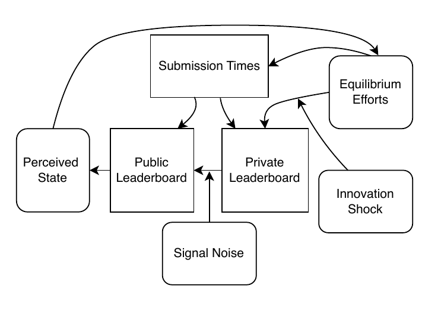
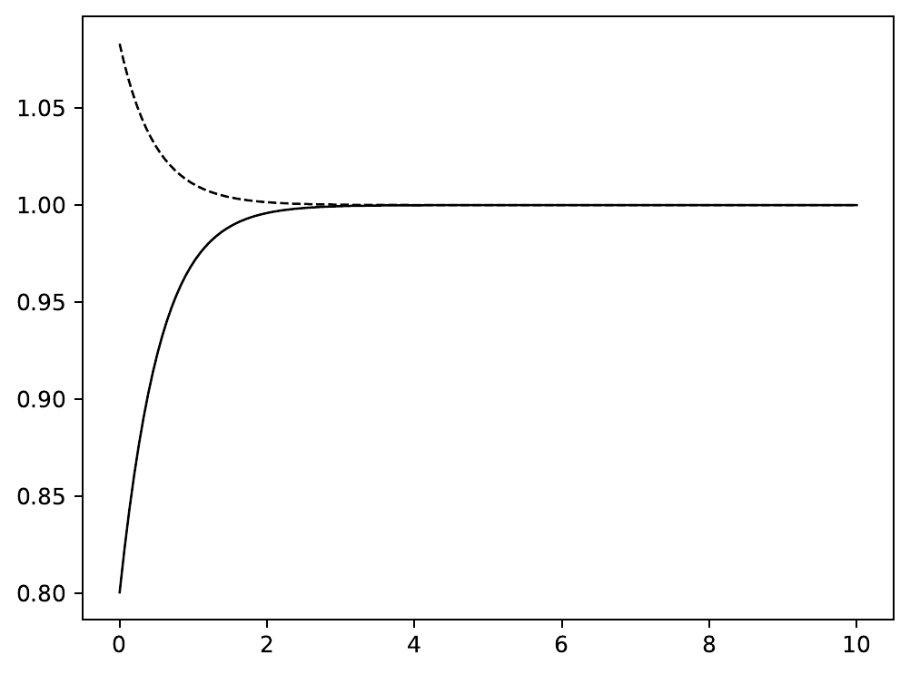
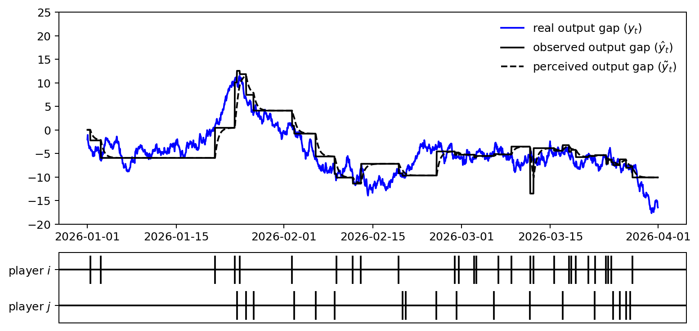
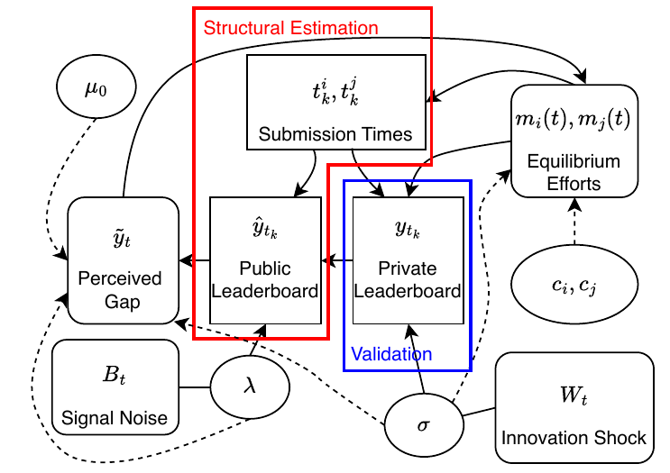
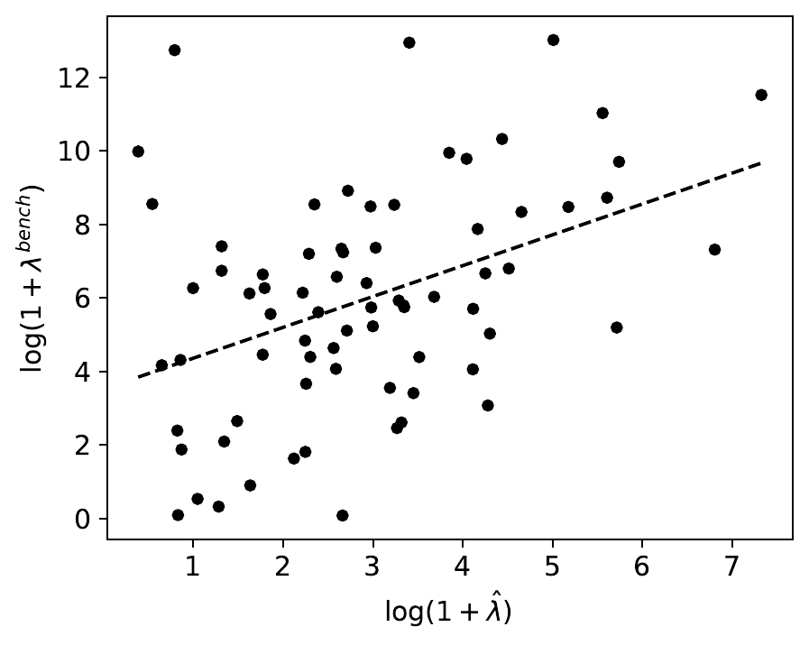
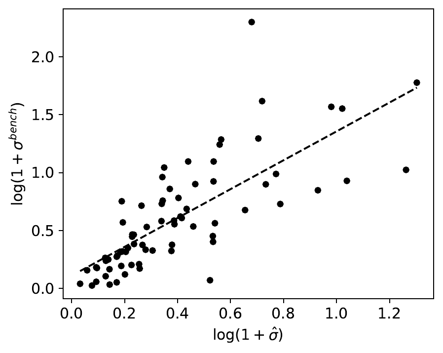
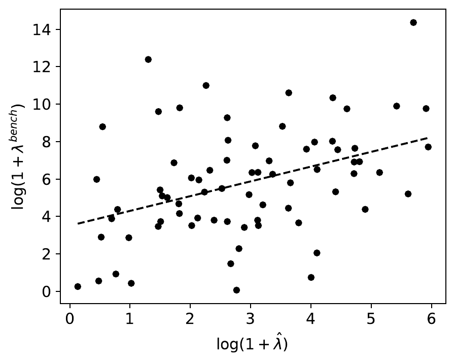
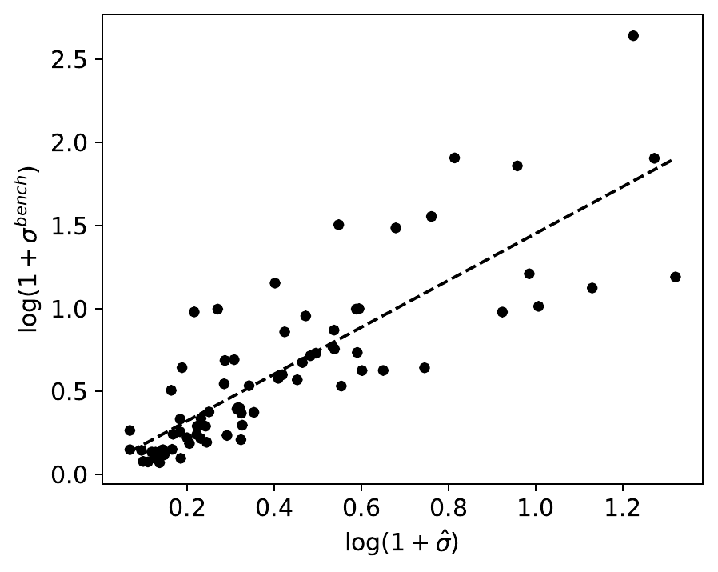

# 动态众包竞赛的贝叶斯结构推断

**作者：** Linsheng Zhuang、Jussi Keppo、Zhi Chen

**作者单位：** Linsheng Zhuang：新加坡国立大学运筹学与分析研究所；大湾区大学智能计算中心。Jussi Keppo：新加坡国立大学商学院、运筹学与分析研究所。Zhi Chen：新加坡国立大学商学院。

> 本文为 `PaperJK7` 的中文全文译本。公式、符号、数值、图表编号与原稿保持一致；参考文献题名保留原文，便于检索。

## 摘要

在线众包竞赛会产生丰富的动态行为，但决定策略的核心状态并不能直接观察：参赛者看到的是带有噪声的公开排行榜，而不是真实的相对表现。本文建立了一个便于求解的动态博弈模型，把贝叶斯滤波纳入其中，并给出相应的结构估计框架。借助这一框架，我们可以还原不可见的竞争状态、努力程度的变化、参赛者在努力成本上的差异、创新波动率，以及公开信号的精度。

模型存在一个闭式的一阶马尔可夫完美均衡。信号精度决定了：即使公开成绩存在差距，奖金激励还能覆盖多大的差距范围。这个结果让我们可以在高频动态环境中进行贝叶斯估计。为了验证模型，我们采用“路径留出”设计：估计似然中不使用私榜路径上的分数，估计完成后再用它们做诊断检验；不过，我们会用最终私榜名次来确定重点研究的竞争双方。比赛期间参赛者看不到这些私榜路径值，但它们和公榜分数来自同一批提交，也采用同一套评分规则。

基于 73 场 Kaggle 竞赛的数据，我们发现，估计出的创新风险越高，私榜路径通常越不稳定。关于信号精度的证据较弱，但方向一致：估计精度越高，公榜和私榜之间的差异越小。这些结果为估计出的结构参数提供了诊断性证据，也展示了如何用该模型研究奖金水平、比赛时长和公开反馈精度。如果初始不确定性固定、提高精度需要付出成本，那么在奖金和时长均有上界时，二阶设计问题存在一个精度有限的联合最优解。要让最优精度严格大于零，一组充分条件是：初始感知差距较小，而且首次引入奖金能带来正的边际回报。

**关键词：** 贝叶斯统计；结构估计；众包竞赛；动态竞赛

## 1. 引言

企业广泛使用众包竞赛，从外部参与者那里征集复杂问题的解决方案。[Kaggle](https://www.kaggle.com)、[Topcoder](https://www.topcoder.com)、[DrivenData](https://www.drivendata.org) 和 [AIcrowd](https://www.aicrowd.com) 等平台已经举办了数千场此类比赛，吸引数据科学家、工程师和开发者为现实问题提交方案。以 Kaggle 为例，一场典型竞赛持续数周。参赛者为了现金奖励反复提交方案，查看自己在公榜上的相对名次，并随着反馈和对手行为的变化调整策略。

这类竞赛面临的核心实证难题是：比赛进行时，真实的竞争状态并不可见。参赛者看到的是带噪声的公榜更新，只能根据滤波后的判断而不是真实状态来决定投入多少努力。研究者在估计时也遇到类似的“部分可观测”问题，因此很难仅凭比赛期间的数据还原策略行为和激励。

为解决这个识别问题，本文建立了一个适用于 Kaggle 等场景的动态竞赛模型和结构贝叶斯估计框架。在这些比赛中，参赛者一边从带噪声的公榜信号中学习，一边连续选择努力水平。我们把该框架应用于 Meta-Kaggle 数据集，从比赛期间的公开信息中还原潜在竞争状态和结构参数，再用未进入似然函数的赛后私榜路径进行评估。

**图 1　典型 Kaggle 竞赛的结构。** 矩形表示可观测数据，圆角矩形表示潜在状态。比赛期间，私榜只有主办方可见，比赛结束后才向所有参赛者公开。参赛者在比赛过程中只能看到每位选手的提交时间和公榜。

图 1 展示了一场典型 Kaggle 竞赛的主要组成部分及其关系。一个重要特征是同时存在两个排行榜：私榜在比赛结束前一直隐藏，最终名次和奖金按私榜决定；公榜则在比赛期间对所有人开放。这样做有两个目的：一是及时向参赛者提供反馈；二是隐藏私榜，减少对公开指标的过拟合，并保留不确定性，让比赛持续保持张力。

排行榜会按参赛者分别更新，而且不同步。参赛者观察公榜后更新判断，形成自己对竞争状态的认识，再按照模型中的马尔可夫完美均衡策略选择努力水平。努力会影响提交强度。某位参赛者提交后，系统会生成他的新分数；对手的显示分数则沿用最近一次提交时的值。尤其是私榜，它会随着实时努力和创新冲击而变化。

我们用贝叶斯方法估计模型的结构参数，数据包括 Meta-Kaggle 中的提交时间和公榜轨迹。估计只使用参赛者在比赛期间能够获得的信息，并利用动态模型所隐含的均衡结构。由此可以还原潜在竞争状态、努力变化、参赛者成本参数、创新不确定性以及公开测量过程的精度。

为了判断模型估计出的参数是否确实具有竞赛含义，我们利用私榜路径检验图 1 中的两项预测：估计的创新风险越高，私榜路径应越波动；估计的信号精度越高，公榜与私榜的差距应越小。估计时不使用私榜路径值，但会用最终私榜名次选择重点参赛者。因此，我们把这些检验解释为：给定赛后选出的竞争双方之后所做的路径留出诊断。我们还采用时间切分方法，用比赛前段公榜数据估计参数，再解释后段私榜结果，以减少“完整路径上的共同变化”造成的影响。

实证部分从 Meta-Kaggle 中严格筛选出 73 场高质量竞赛，并统一预处理。给定重点参赛者的选择规则后，我们只用比赛期间的公开信息，为每场竞赛估计创新风险和信号精度。结果显示，结构估计得到的创新风险与私榜波动显著正相关，时间切分检验也支持这一结论。信号精度的证据较弱，但方向一致：估计精度越高，公榜和私榜的分歧越小；换一种重点参赛者配对方式后，结构精度与基准精度之间仍是正相关。

本文有两项主要贡献。第一，我们为存在带噪公开反馈和潜在表现变化的竞赛建立了动态博弈模型及结构贝叶斯框架。与强调“提交还是退出”等离散决策的模型不同，我们直接刻画努力的连续积累，并把根据信号更新判断放在结构的中心。我们沿用 Ryvkin（2022）的均衡结构，让隐藏到比赛结束的私榜决定赢家。这样，公开反馈的信息量会改变均衡努力激励，同时模型仍保留可用于结构估计的闭式均衡。

第二，我们把未进入似然函数的私榜路径作为估计后的验证目标。由于最终私榜名次参与了重点竞争者的选择，这些检验仍应理解为给定赛后配对的路径留出诊断。它让我们能够判断估计结构是否真的抓住了创新不确定性和信号精度，而不只是拟合了比赛期间观察到的行为。这些结果为还原出的竞赛参数提供了估计后证据，也说明该模型可用于机制评估和平台设计。

### 1.1 相关文献

**竞赛设计。** 静态竞赛设计文献通常借助“竞赛成功函数”把努力映射成获胜概率，研究如何安排奖金、参与规则和信息披露来激发表现。本文研究的是会反复反馈的动态环境，因此这类文献主要构成机制设计问题的背景。

动态竞赛主要有两种建模路线。第一种把竞赛看成多阶段过程：参赛者持续投入努力，同时面对中间进展的不确定性，因此可以研究主办方在比赛中途采用的反馈披露和筛选机制。典型的两阶段模型把第一阶段理解为可行性探索或基础实验，主办方通过里程碑反馈披露进展；最终成果由早期表现和之后的改进共同决定。另一些模型让参与者投入连续努力，依次完成可能不可行的 A 阶段和可行的 B 阶段，突破由泊松过程控制。还有研究讨论不完全筛选机制：只有产生可行想法的参赛者才能进入执行阶段。

第二种路线与本文更接近：产出是随机过程，其漂移取决于努力。它源自“拉锯战”框架，最早被用作多阶段研发竞赛的一维简化。后续研究把每位选手的进展表示为布朗运动。例如，双寡头创新竞赛中的状态可随双方努力差而作布朗运动；也有研究直接把双方产出差作为博弈状态，并在纯策略下求出闭式均衡。Ryvkin（2022）进一步研究有固定截止时间的动态竞赛，得到马尔可夫完美均衡的闭式解。

在数据科学竞赛中，公开反馈精度本身也是一种设计工具。Huang（2024）研究训练集与测试集的划分，发现更充分的中期反馈虽然让排名在统计上更可靠，却也最容易诱使参赛者提交高方差、并非最优的模型；近期 Kaggle 竞赛的证据与这一机制相符。本文研究的是另一条渠道：信号更精确会改善判断更新，使公榜排名更能预测私榜赢家。

本文关注的在线众包竞赛通常有固定截止时间、反复提交和实时公开反馈，并受平台规则和评估指标约束。Ryvkin（2022）的简化使动态模型具有闭式均衡，结构估计在分析和计算上都可行。本文在其完全信息环境中加入带噪公开信号与贝叶斯滤波，从而把部分可观测性纳入一个仍然便于求解的动态竞赛模型。

**竞赛的结构估计。** 越来越多的研究用结构估计从观察数据中还原竞赛环境的关键参数。对静态竞赛而言，如果成功函数已明确给出，主要目标是估计它的形式或参数；如果成功函数不明确或不光滑，则常依赖均衡的一阶条件。比如，有研究用类似 EM 算法的两步半参数方法，同时估计不可观测的拍卖异质性和竞标者成本分布；拍卖模型中也常先非参数估计价值结构，再做后续结构估计。

动态结构估计通常依赖动态博弈的马尔可夫完美均衡，但贴近现实的数据模型往往没有闭式解。例如，有研究用离散时间、状态和行动的有限期动态博弈刻画在线标志设计竞赛中创作者如何回应反馈，再基于 810 场竞赛做两步极大似然估计：先估计各行动对应的状态转移概率，再还原效用参数。另有研究用 Topcoder 数据分析参与者如何在多场竞赛中学习和选择，发现与明星选手竞争能带来更充分的反馈、加快学习。

与本文最接近的是 Lemus（2021）对 Kaggle 行为的结构估计。他们建立有限期动态博弈：每次提交后，参赛者决定继续还是退出，本质上是最优停止问题。提交在随机时间到达，并产生私人成本。他们先用极大似然和 EM 算法估计类型与分数分布等基础参数，再用条件选择概率估计成本分布。本文有两点不同：（1）把提交视为努力积累的结果，而不是离散且有成本的行动；（2）把带噪信号下的判断更新明确建模为影响行为和识别的结构渠道，而不是采用较粗的行为近似。

下文安排如下：第 2 节介绍理论模型，第 3 节给出贝叶斯估计框架，第 4 节讨论合成数据实验，第 5 节应用于 Kaggle 实际数据，并用未进入似然的私榜路径评价估计参数。论文将同时提供复现代码和实现细节。

## 2. 模型

两位选手 $i$ 和 $j$ 争夺奖金 $\theta>0$，赢家获得全部奖金，输家得零。比赛从 0 时刻开始，在固定截止时间 $T>0$ 结束。在每个 $t\in[0,T)$，选手 $k\in\{i,j\}$ 选择努力 $q_{k,t}\ge 0$，即时成本为 $C_k(q_{k,t})=c_kq_{k,t}^2/2$。其中 $c_k>0$，$c_k$ 越小，能力越高。

令 $y_t$ 表示选手 $i$ 与 $j$ 在 $t$ 时刻不可见的私榜分数差：

$$
dy_t=(q_{i,t}-q_{j,t})dt+\sigma dW_t. \tag{1}
$$

$W_t$ 是布朗运动，$\sigma>0$ 表示创新风险。努力给定时，$\sigma$ 越大，表现变化越不确定。

现实中，参赛者会在不同时间提交方案。每次提交都会更新提交者的公榜和私榜分数，而计算双方差距时，对手沿用最近一次提交的分数。为了便于分析，我们用连续时间的公开信号来近似这些不规则、由提交触发的更新：

$$
dZ_t=y_tdt+\frac{dB_t}{\sqrt\lambda}, \tag{2}
$$

其中 $B_t$ 是与 $W_t$ 独立的标准布朗运动，$\lambda>0$ 控制信号精度。$\lambda$ 越大，噪声越小，反馈越有信息；实证上，它对应公榜对潜在相对表现的信息量。

模型参数是共同知识。公开提交活动可以近似反映努力，理论模型进一步把过去的努力视为双方都能观察。双方都没有关于 $y_t$ 的额外私人信息。我们研究公开马尔可夫均衡。令 $I_t$ 表示公榜信号和过去努力形成的共同历史，定义后验均值与方差
$\tilde y_t=E(y_t\mid I_t)$ 和 $S_t=E[(y_t-\tilde y_t)^2\mid I_t]$。初始时，$y_0\mid I_0\sim\mathcal N(\tilde y_0,S_0)$，$\tilde y_0$ 为公开知识，$S_0>0$ 且不随 $\lambda$ 改变。

在线性高斯假设下，Kalman-Bucy 滤波给出

$$
d\tilde y_t=(q_{i,t}-q_{j,t})dt+\lambda S_t(dZ_t-\tilde y_tdt), \tag{3}
$$

$$
\frac{dS_t}{dt}=\sigma^2-\lambda S_t^2. \tag{4}
$$

因此 $y_t\mid I_t\sim\mathcal N(\tilde y_t,S_t)$，后验状态完全由 $(\tilde y_t,S_t)$ 描述。式（4）的稳态是 $\bar S=\sigma/\sqrt\lambda$。给定 $S_0$ 后，$S_t$ 是确定路径，所以 $(\tilde y_t,t)$ 仍是充分策略状态；附录给出了显式解。

**图 2　后验方差 $S_t$ 向稳态收敛。** 当 $\lambda=\sigma=1$ 时，实线从稳态下方出发，虚线从稳态上方出发，两者都收敛到 $\bar S=1$。横轴为时间，纵轴为后验方差。

$y_T$ 的正负决定赢家。比赛结束、私榜尚未揭晓前的共同信息记为 $I_T$。由于 $y_T\mid I_T\sim\mathcal N(\tilde y_T,S_T)$，两位选手的期望终局奖金分别为
$G_i(\tilde y_T)=\theta\Phi(\tilde y_T/\sqrt{S_T})$ 和 $G_j(\tilde y_T)=\theta\Phi(-\tilde y_T/\sqrt{S_T})$。

令 $m_k(\tilde y,t)$ 为选手 $k$ 的均衡马尔可夫努力策略。把 $j$ 的策略视为给定，$i$ 的价值为

$$
V^i(\tilde y,t)=\sup_{\{q_{i,\tau}\ge0\}}E\left[G_i(\tilde y_T)-\int_t^T C_i(q_{i,\tau})d\tau\mid\tilde y_t=\tilde y\right].
$$

优化对象是关于 $I_\tau$ 可预测、且满足 $E\int_t^Tq_{i,\tau}^2d\tau<\infty$ 的非负努力过程。选手 $j$ 的问题可通过把 $\tilde y$ 换成 $-\tilde y$ 并交换标签与成本参数得到。选手 $i$ 的 HJB 方程为

$$
0=\max_{q_{i,t}\ge0}\left[-\frac{c_iq_{i,t}^2}{2}+V_y^i(q_{i,t}-m_j)+V_t^i+\frac{\lambda S_t^2}{2}V_{yy}^i\right].
$$

内点均衡的一阶条件为 $q_{i,t}=V_y^i/c_i$、$q_{j,t}=-V_y^j/c_j$，从而

$$
\begin{aligned}
\frac{(V_y^i)^2}{2c_i}+\frac{V_y^iV_y^j}{c_j}+V_t^i+\frac{\lambda S_t^2}{2}V_{yy}^i&=0,\\
\frac{(V_y^j)^2}{2c_j}+\frac{V_y^jV_y^i}{c_i}+V_t^j+\frac{\lambda S_t^2}{2}V_{yy}^j&=0.
\end{aligned}
$$

边界条件是 $V^i(-\infty,t)=0$、$V^i(+\infty,t)=\theta$、$V^j(-\infty,t)=\theta$、$V^j(+\infty,t)=0$；终端条件是 $V^i(\tilde y,T)=G_i(\tilde y)$、$V^j(\tilde y,T)=G_j(\tilde y)$。

**定理 1（均衡存在性与一阶努力）。** 固定 $T,\theta,\sigma,\lambda,S_0>0$，其中 $S_0$ 不依赖 $\lambda$。令 $w_k=\theta/(\sigma^2c_k)$。当 $w_i+w_j$ 足够小时，存在内点马尔可夫完美均衡，且

$$
m_k(\tilde y_t,t)=\frac{\sigma^2w_k}{\sqrt{Q_t}}\left\{\frac{1}{\sqrt{2\pi}}\exp\left[-\frac{\tilde y_t^2}{2Q_t}\right]+O(w_i+w_j)\right\},
\quad Q_t=\sigma^2(T-t)+S_t. \tag{5}
$$

当 $(w_i,w_j)\to(0,0)$ 时，上式对两位选手以及所有 $(\tilde y_t,t)\in\mathbb R\times[0,T)$ 一致成立。

$Q_t$ 同时包含对当前真实差距的不确定性 $S_t$ 和剩余时间内的创新风险 $\sigma^2(T-t)$。在一阶近似下，努力与 $\theta/c_k$ 成正比；当共同判断的差距为零时，边际改进最能提高胜率，因此努力最高。$Q_t$ 越大，努力峰值越低，但激励会延伸到更宽的差距范围。

### 2.1 对竞赛设计的含义

令 $x_t^k$ 为选手 $k$ 的私有表现分数，并规范化为

$$
\frac{x_0^i+x_0^j}{2}=0,\qquad y_0=x_0^i-x_0^j,\qquad y_0\mid I_0\sim\mathcal N(\tilde y_0,S_0). \tag{6}
$$

单个选手的分数按

$$
dx_t^k=q_{k,t}dt+\frac{\sigma}{\sqrt2}dW_t^k \tag{7}
$$

变化，其中 $W^i,W^j$ 独立，均衡时 $q_{k,t}=m_k(\tilde y_t,t)$。主办方关心终局最佳分数：

$$
\mathcal B(\tilde y_0,\theta,T,\lambda;S_0)=E[\max\{x_T^i,x_T^j\}\mid I_0].
$$

**引理 1（总期望努力）。** 若 $c_i=c_j=c$，令
$M(\tilde y_t,t)=E[\int_t^T(m_i+m_j)ds\mid\tilde y_t]$。当 $w=\theta/(\sigma^2c)\downarrow0$ 时，

$$
M(\tilde y_t,t)=\frac{2\sigma^2(T-t)}{\sqrt{Q_t}}\left\{\frac{w}{\sqrt{2\pi}}\exp\left[-\frac{\tilde y_t^2}{2Q_t}\right]+O(w^2)\right\}. \tag{8}
$$

**引理 2（期望最佳产出）。** 在式（6）及引理 1 的条件下，$\mathcal B=\bar{\mathcal B}+O(w^2\sigma^2T/\sqrt{Q_0})$，其中 $Q_0=S_0+\sigma^2T$，

$$
\begin{aligned}
\bar{\mathcal B}&=\sqrt{\frac{Q_0}{2\pi}}e^{-\tilde y_0^2/(2Q_0)}
+|\tilde y_0|\left[\Phi\left(\frac{|\tilde y_0|}{\sqrt{Q_0}}\right)-\frac12\right]\\
&\quad+\frac{\theta T}{c\sqrt{2\pi Q_0}}e^{-\tilde y_0^2/(2Q_0)}.
\end{aligned}
\tag{9}
$$

二阶近似为

$$
\mathcal B^{(2)}=\bar{\mathcal B}+\frac{\theta^2}{c^2}\mathcal R(\tilde y_0,T,\lambda;S_0), \tag{10}
$$

固定 $T,\sigma,\lambda,S_0>0$ 时，$\mathcal B=\mathcal B^{(2)}+O(w^3)$，且 $\mathcal R\ge0$；其定义见证明中的式（A.14）。

式（9）前两项是不投入努力时的期望最佳产出，最后一项等于一阶总努力的一半。因为 $S_0$ 固定，一阶产出不依赖 $\lambda$；精度首次通过二阶反应影响产出：双方努力的修正会在总努力中互相抵消，却会改变终局差距。

主办方选择奖金、截止时间和公开信号精度。令 $u$ 是连续可微、严格递增的期望最佳产出效用，$D$ 是连续可微、非递减且 $D(0)=0$ 的延迟成本；精度成本为 $\kappa\lambda^2/2$。近似设计问题是

$$
\max_{0\le\theta\le\bar\theta,\,0\le T\le\bar T,\,\lambda\ge0}
u(\mathcal B^{(2)})-\theta-D(T)-\frac\kappa2\lambda^2. \tag{11}
$$

$\lambda=0$ 表示完全没有公开信号，此时 $S_t=S_0+\sigma^2t$。奖金范围针对较小的激励指数。下面命题讨论的是近似目标，而不是在所有精度上对精确均衡设计问题作一致近似。

**命题 1（联合竞赛设计）。** 在成本对称、$\sigma,S_0>0$ 且满足上述假设时，问题（11）存在全局最优解，每个最优解的精度都有限。如果还满足 $\tilde y_0^2\le S_0/6$，并且对某个无奖金时的最优期限 $T_0$，

$$
u'(\bar{\mathcal B}(\tilde y_0,0,T_0;S_0))
\frac{T_0e^{-\tilde y_0^2/[2(S_0+\sigma^2T_0)]}}{c\sqrt{2\pi(S_0+\sigma^2T_0)}}>1, \tag{12}
$$

那么每个最优解都满足 $\theta^*>0$、$T^*>0$ 和 $0<\lambda^*<\infty$。若 $\theta^*<\bar\theta$、$T^*<\bar T$，必要的一阶条件为

$$
\begin{aligned}
u'(\mathcal B^{(2)})\left[\bar{\mathcal B}_\theta+\frac{2\theta^*}{c^2}\mathcal R\right]&=1,\\
u'(\mathcal B^{(2)})\mathcal B_T^{(2)}&=D'(T^*),\\
u'(\mathcal B^{(2)})\frac{(\theta^*)^2}{c^2}\mathcal R_\lambda&=\kappa\lambda^*.
\end{aligned} \tag{13}
$$

这些条件不保证解唯一。精度成本不断上升，因此不可能无限披露。严格正的披露需要额外论证：初始感知差距相对初始不确定性较小时，小幅提高精度会增加二阶产出，而零点的边际精度成本为零。式（12）保证主办方更愿意举办有奖金的竞赛。差距条件只是充分条件，并非必要条件。

## 3. 估计框架

本节区分结构数据生成过程与实际估计所用的一阶模型。我们先把结构模型对应到可观察的竞赛数据，再用定理 1 的均衡策略建立近似贝叶斯似然。

### 3.1 数据生成过程

每场 Kaggle 竞赛的 Meta-Kaggle 数据分为三部分。第一部分是竞赛层面的制度特征，包括时长、奖金结构和信息披露规则。为了对应两人、赢家通吃的模型，我们只保留很可能存在主要头部竞争，且现金激励能换算成前两名获胜收益差的竞赛。有效奖金 $\theta$ 是观察值，不参与估计；所有竞赛的奖金均以 10 万美元为单位。

第二部分是选手 $i$ 的提交事件 $\{\hat t_k^i\}_{k=1}^{N_i}$。给定均衡努力路径，我们把 $i,j$ 的提交分别建模为强度为 $\tau_i(t),\tau_j(t)$ 的非齐次泊松过程；给定努力路径后，两者条件独立。任意区间 $\mathcal S$ 内，$i$ 的期望提交次数为 $\int_\mathcal S\tau_i(s)ds$。为把提交时间与潜在努力联系起来，假设

$$
\tau_i(t)=r\,m_i(\tilde y_t,t), \tag{14}
$$

其中 $r>0$ 把模型中的努力换算成提交强度。对 $j$ 也一样。这是方便实证的测量假设，并非理论博弈推导出的结论；$r$ 是辅助尺度参数，而不是竞赛的基础参数。

第三部分是公榜与私榜序列，分别记为 $\hat x_t^{i(j)}$ 和 $x_t^{i(j)}$。公榜用公开样本计算，私榜用留出样本计算且比赛结束后才公布。定义潜在同期差距 $y_t=x_t^i-x_t^j$，显示的公榜差距 $\hat y_t=\hat x_t^i-\hat x_t^j$。由于提交不同步，$\hat y_t$ 未必比较的是双方同期提交。它是式（2）带噪信号的实证对应物，只在提交触发时更新。我们采用读出约定

$$dZ_t=\hat y_tdt, \tag{15}$$

从而形式上有

$$\hat y_t=y_t+\lambda^{-1/2}\xi_t,\qquad \xi_t=dB_t/dt. \tag{16}$$

白噪声不能逐点观察，所以式（16）不是逐点抽样方程。若 $t_k$ 为一次更新，$h_k=t_k-t_{k-1}$，在该读出区间取平均后，噪声为 $\varepsilon_k\sim\mathcal N(0,1/(\lambda h_k))$。用区间终点近似潜在差距，并代入状态方程，可得

$$
\hat y_{t_k}\approx y_0+\int_0^{t_k}[m_i(\tilde y_s,s)-m_j(\tilde y_s,s)]ds+\sigma W_{t_k}+\varepsilon_k. \tag{17}
$$

$\sigma W_{t_k}$ 是累积创新噪声，$\varepsilon_k$ 是本次排行榜更新的信号噪声。实际初始差距在比赛中不可见，我们令

$$y_0\sim\mathcal N(\mu_0,S_0),\qquad S_0>0, \tag{18}$$

并在似然中把 $y_0$ 积分掉。$\mu_0$ 是初始感知差距，$S_0$ 是初始不确定性，与之后的 $\sigma$ 和 $\lambda$ 分开。

理论模型有连续信号，实际公榜却只在异步提交时观察。精确实现需要在提交间连续预测、提交时离散更新的混合滤波器。为了保留易处理的连续更新表示，我们在两次更新之间沿用最近的公榜差距，并用确定的 $S_t$ 路径和一阶努力策略递推：

$$
d\tilde y_t=[m_i^{(1)}-m_j^{(1)}]dt+\lambda S_t(\hat y_t-\tilde y_t)dt,\qquad \tilde y_0=\mu_0. \tag{19}
$$

长时间没有提交时，这个近似可能高估学习速度。因此，估计值应理解为以连续更新近似为条件的结果。待估参数为
$\Theta=(c_i,c_j,\sigma,\lambda,\mu_0,r,S_0)$。结构数据生成过程由完整策略 $m$ 决定，实际似然则用 $m^{(1)}$ 代替。

### 3.2 建模上的几点考虑

**策略性提交时间。** 排榜只在新提交后刷新；没有活动时，它不提供新信息。若参赛者刻意延迟或扣住提交，推断就可能有偏。基准观察方程把提交看作潜在努力的结果，没有显式描述这种行为。我们的结果更适合“主动更新占主导”的竞赛。样本筛选要求重点选手达到最低提交次数，从而减少稀疏且高度策略化的情形。

**两人近似。** 真实竞赛有很多参赛者，缩减为两人会改变策略外部性和信息结构。本文把模型理解为对头部集中竞争的一种近似。稳健性分析会改变重点双方的定义，检查结果是否依赖特定配对。

**高斯近似。** 模型假设信号冲击和创新冲击服从高斯分布。把有界的排行榜分数映射到实数状态空间，需要既做变换，也保留分布近似。缩放只能改变单位，不能证明分布是高斯的，因此高斯性始终是一项建模假设。

### 3.3 贝叶斯估计

给定重点竞争双方后，似然只使用比赛期间的提交时间和公榜更新。数值积分采用步长为 $\Delta_{\rm num}$ 的均匀网格；这个计算步长不决定观察噪声方差。选手 $i$ 的提交时间似然为

$$
p(\{t_k^i\}_{k=1}^{N_i}\mid\tau_i^{(1)},\Theta)
=\exp\left[-\int_\mathcal T\tau_i^{(1)}(s)ds\right]\prod_{k=1}^{N_i}\tau_i^{(1)}(t_k^i), \tag{20}
$$

其中 $\tau_i^{(1)}=rm_i^{(1)}$；$j$ 的形式对称。积分项在计算网格上求值。

公榜差距只在任一选手提交并获得更新时进入似然。把所有更新时间排序为 $(t_1,\ldots,t_N)$，$N=N_i+N_j$，并令 $h_k=t_k-t_{k-1}$、$t_0=0$。$h_k$ 是真实日历时间，与数值步长不同。令 $\mathcal F_{k-1}$ 为 $t_k$ 之前的提交和公榜历史，则递推产生一步预测分布

$$
\hat y_{t_k}\mid\mathcal F_{k-1},\Theta\sim\mathcal N(\mu_{k\mid k-1},V_{k\mid k-1}),
$$

从而

$$
p(\{\hat y_{t_k}\}_{k=1}^N\mid\Theta)=\prod_{k=1}^N\phi(\hat y_{t_k}\mid\mu_{k\mid k-1},V_{k\mid k-1}). \tag{21}
$$

每个观测先按一步预测密度评分，再进入状态递推，所以不会影响自己的预测均值，只影响之后的状态和努力路径。预测密度还对式（18）的初始分布积分。这样既使用了提交时对应的公榜值，也保持了信息的时间顺序。

尽管赛后可以在 Meta-Kaggle 中看到私榜轨迹 $y_t$，我们刻意不把它放进似然。参赛者只根据 $\hat y_t$ 判断 $y_t$ 并采取行动；估计时直接条件化于真实 $y_t$，等于绕开参赛者的信息约束，也会削弱 $\lambda$ 在判断形成中的作用，更会破坏私榜路径留出设计。把 $y_t$ 当作潜变量，既保留行为解释，也允许估计后验证；最终私榜名次仍用于配对。

实际计算中，以如下闭式一阶策略代替非线性均衡策略：

$$
m_k^{(1)}(\tilde y_t,S_t,t)=\frac{\theta}{c_k\sqrt{2\pi Q_t}}
\exp\left(-\frac{\tilde y_t^2}{2Q_t}\right),\qquad Q_t=S_t+\sigma^2(T-t). \tag{22}
$$

给定 $\Theta$ 后，先由式（4）确定 $S_t$，再由式（19）向前构造感知状态和努力路径。所得后验同时依赖一阶均衡近似和连续更新近似。闭式策略可以直接放进 Hamiltonian Monte Carlo 与 NUTS 采样器。

先验设定为：$c_i,c_j\sim\operatorname{LogNormal}(\log1,0.75^2)$，$\sigma\sim\operatorname{LogNormal}(\log2,0.5^2)$，$\lambda\sim\operatorname{LogNormal}(\log1,0.75^2)$，$S_0\sim\operatorname{LogNormal}(\log2,0.75^2)$，$r\sim\operatorname{LogNormal}(\log10,0.5^2)$，$\mu_0\sim\mathcal N(\hat y_{t_1},1)$。所有正参数下界为 0.01、无上界。$\mu_0$ 的先验中心使用首个公榜差距，因此属于经验贝叶斯初始化。

**命题 2（局部识别）。** 若 $\theta>0$，公榜至少在三个不同时间被观察，所有 $h_k>0$，且 $c_i\ne c_j$，那么在所采用的一阶实证模型下，参数向量 $\Theta$ 可由式（20）和（21）局部识别。当 $c_i$ 接近 $c_j$ 时识别变弱；两者相等时识别失败。证明见附录。

## 4. 合成实验

我们用第 2 节的完整均衡策略 $m$ 生成合成竞赛，该策略通过数值求解非线性 HJB 系统得到；估计时仍使用式（22）的一阶近似。实验比较稳态初始化 $S_0=\sigma/\sqrt\lambda$ 与 $S_0=4$，其他参数、随机数和模拟规则保持不变。

**算法 1　合成数据模拟**

1. 输入 $\Delta,T,\theta,c_i,c_j,\sigma,\lambda,r,\tau^\star,\mu_0,S_0$。
2. 求解 $S_t$ 与非线性 HJB 系统，得到 $m_i,m_j$；抽取 $y_0\sim\mathcal N(\mu_0,S_0)$。
3. 从强度上界为 $\tau^\star$ 的泊松过程中抽取候选提交，并为每个候选点抽取均匀随机数；在网格上独立抽取创新与信号噪声。
4. 初始化 $\hat y_0=\tilde y_0=\mu_0$。每个网格步先计算努力和强度，再按式（1）更新 $y$，按连续更新近似更新 $\tilde y$。
5. 用 thinning 规则 $u_s<\tau_{i(j)}(t)/\tau^\star$ 接受提交。若本小时至少接受一次提交，则用方差取决于距上次读出时间的噪声刷新公榜，否则沿用旧值。
6. 输出 $S_t,y_t,\tilde y_t,\hat y_t,m_i,m_j$ 以及双方提交时间。

网格步长为一小时，即 $\Delta=1/24$ 天。HJB 状态网格间距为 0.2，时间步长为 $1/48$ 天；把两者都减半后，共同评估网格上的努力变化不超过峰值的 0.43%。提交保留候选事件的精确时间，但公榜每小时最多刷新一次。

基准竞赛持续 90 天，参数为 $c_i=1.2,c_j=1.5,\theta=1,\sigma=2,\lambda=1,\mu_0=0,S_0=4,r=15$。时间单位为天。初始不确定性是稳态方差 2 的两倍，激励指数约为 $w_i=0.208,w_j=0.167$。配对的稳态模拟中，双方分别提交 30 和 19 次；改用从 $S_0=4$ 出发的变化方差后，分别提交 28 和 18 次。

**图 3　三个月跨度的合成竞赛数据。** 上图显示潜在差距、向前沿用的公榜差距和感知差距；下图记录双方提交时间。路径使用数值求得的完整均衡策略和 $S_0=4$。

表 1 使用同一份完整样本并联合估计 $r$。A 部分强制 $S_0=\sigma/\sqrt\lambda$；B 部分把 $S_0$ 作为独立的干扰参数估计。两种初始化的结果相近，所有 95% 可信区间都包含真实值；但这只是单个样本，不能说明不存在系统偏差。桥接抽样得到的边际似然几乎相同，先验中位数改为 1 或 4 时，非稳态相对稳态的贝叶斯因子在 0.97 到 1.01 之间。样本几乎没有提供单独估计初始方差的证据。BIC 偏好稳态限制，但似然最优点位于边界附近，常规渐近解释并不可靠。

**表 1　不同初始化下的贝叶斯估计**

| 统计量 | $c_i$ | $c_j$ | $\sigma$ | $\lambda$ | $\mu_0$ | $r$ |
|---|---:|---:|---:|---:|---:|---:|
| **A. 稳态初始化**：真实值 | 1.2 | 1.5 | 2.0 | 1.0 | 0.0 | 15.0 |
| 后验均值 | 1.168 | 1.763 | 2.170 | 1.562 | -0.466 | 13.878 |
| 后验标准差 | 0.399 | 0.631 | 0.249 | 0.596 | 0.900 | 4.159 |
| 后验 RMSD | 0.400 | 0.684 | 0.302 | 0.820 | 1.014 | 4.307 |
| 95% 区间 | [0.58,2.14] | [0.83,3.34] | [1.74,2.71] | [0.69,2.99] | [-2.24,1.25] | [7.53,23.61] |
| **B. 非稳态初始化**：后验均值 | 1.149 | 1.727 | 2.169 | 1.560 | -0.427 | 13.677 |
| 后验标准差 | 0.399 | 0.622 | 0.253 | 0.599 | 0.940 | 4.101 |
| 后验 RMSD | 0.402 | 0.662 | 0.304 | 0.820 | 1.032 | 4.309 |
| 95% 区间 | [0.57,2.13] | [0.82,3.21] | [1.74,2.72] | [0.67,3.02] | [-2.22,1.42] | [7.41,23.46] |

| 模型比较 | 稳态 | 非稳态 |
|---|---:|---:|
| 估计参数数目 | 6 | 7 |
| 对数边际似然 | -359.124 | -359.127 |
| 最大对数似然 | -352.922 | -352.717 |
| BIC（$n=45$） | 728.684 | 732.080 |

*注：* 两种模型都使用 46 次提交和 45 次小时级读出，不删除初始观测。每个模型用 4 条链，1,000 次预热、每链保留 2,000 个样本；无发散，最大 $\widehat R<1.002$。RMSD 是后验相对生成参数的均方距离平方根，并非跨数据集 RMSE。区间为等尾 95% 可信区间。BIC 仅作启发式比较。

### 4.1 更丰富数据下的参数恢复

我们比较汇集多场独立竞赛和延长单场竞赛两种做法。数据都由非线性策略 $m$ 与 $S_0=4$ 生成，而估计统一施加稳态限制并联合估计 $(c_i,c_j,\sigma,\lambda,\mu_0,r)$。

**重复竞赛。** 把 10 场和 20 场独立竞赛分别汇集；每场都有自己的初始差距、创新、信号噪声和提交事件，但共享参数。每场单独初始化潜在状态，似然合并。

**表 2　汇集合成数据的贝叶斯估计**

| 样本与统计量 | $c_i$ | $c_j$ | $\sigma$ | $\lambda$ | $\mu_0$ | $r$ |
|---|---:|---:|---:|---:|---:|---:|
| 真实值 | 1.2 | 1.5 | 2.0 | 1.0 | 0.0 | 15.0 |
| 10 场：后验均值 | 1.168 | 1.326 | 1.994 | 0.889 | -0.195 | 14.477 |
| 10 场：后验标准差 | 0.355 | 0.405 | 0.074 | 0.118 | 0.666 | 4.314 |
| 10 场：后验 RMSD | 0.357 | 0.441 | 0.075 | 0.162 | 0.694 | 4.346 |
| 20 场：后验均值 | 1.174 | 1.325 | 2.031 | 1.039 | 0.090 | 14.492 |
| 20 场：后验标准差 | 0.354 | 0.402 | 0.054 | 0.108 | 0.542 | 4.334 |
| 20 场：后验 RMSD | 0.355 | 0.438 | 0.062 | 0.115 | 0.549 | 4.364 |

10 场与 20 场样本分别有 426/848 次提交及 418/836 次小时读出。竞赛数增加后，$\sigma,\lambda,\mu_0$ 的后验标准差下降，但 $c_i,c_j,r$ 的不确定性变化很小，所以更多竞赛不会同等改善所有参数。

**更长的竞赛。** 接着考察 180 天和 360 天的单场竞赛，其他结构参数不变。$r_{180}=18.6484375$、$r_{360}=47.4375$，它们原本按一阶稳态基准校准，改变努力策略和 $S_0$ 后不再重新校准。

**表 3　更长合成竞赛的贝叶斯估计**

| 样本与统计量 | $c_i$ | $c_j$ | $\sigma$ | $\lambda$ | $\mu_0$ | $r$ |
|---|---:|---:|---:|---:|---:|---:|
| 180 天：真实值 | 1.2 | 1.5 | 2.0 | 1.0 | 0.0 | 18.648 |
| 后验均值 | 1.165 | 1.249 | 2.190 | 1.444 | -0.362 | 18.230 |
| 后验标准差 | 0.374 | 0.404 | 0.177 | 0.367 | 0.959 | 5.450 |
| 后验 RMSD | 0.376 | 0.476 | 0.260 | 0.576 | 1.025 | 5.466 |
| 360 天：真实值 | 1.2 | 1.5 | 2.0 | 1.0 | 0.0 | 47.438 |
| 后验均值 | 1.074 | 1.445 | 2.085 | 1.033 | -0.596 | 45.969 |
| 后验标准差 | 0.327 | 0.442 | 0.096 | 0.189 | 0.921 | 13.654 |
| 后验 RMSD | 0.350 | 0.446 | 0.128 | 0.191 | 1.097 | 13.732 |

360 天样本对 $\sigma$ 和 $\lambda$ 的后验标准差更小，但 $\mu_0$ 的标准差仍接近先验值 1；汇集独立竞赛对它改善得更多。这些差异还包含具体随机样本与不同提交尺度的影响，不能解释为纯粹的时长效应。

## 5. 实证应用

本节把包含后验判断的努力模型应用于真实 Kaggle 竞赛，用私榜基准检查还原出的参数，并据此评估精度、奖金和时长的反事实选择。我们根据提交频率、活跃时段和最终名次，为每场竞赛确定两位重点选手，构造双方提交时间和公榜差距，采用统一先验逐场估计。信号精度既影响观察噪声，也通过 $Q_t(\lambda)$ 影响努力激励。

似然仍只使用比赛期间的提交与公榜轨迹。私榜路径值不进入估计，但最终私榜名次参与配对，所以验证是“给定所选双方”的诊断，而不是完全独立样本上的验证。这里的私榜路径，是比赛结束后根据历史提交还原出的私榜分数序列，并非参赛者当时能够看到的路径。

**图 4　Meta-Kaggle 数据与模型结构。** 矩形为观察数据，圆角矩形为潜在状态，椭圆为竞赛参数；实线表示时序与状态关系，虚线表示参数对数据生成过程的影响。私榜 $y_t$ 在比赛中不可见，其路径不进入似然，只用于估计后验证；最终私榜名次用于选取重点双方。

### 5.1 为结构估计准备数据

第一项筛选标准是现金奖励。我们保留以美元计价、设有一至三档现金奖励的竞赛。一档奖金自然符合赢家通吃；两档或三档奖金则以第一、第二名的奖金差作为有效获胜收益。这样可以减轻奖牌等象征性激励的干扰。

第二项标准是找出两位高度活跃、最终名次靠前且参赛时段充分重叠的选手。候选人从最终私榜顶部开始选择，每人至少提交五次，并满足样本构建中的时间重叠要求。两人模型是对头部竞争的一种结构近似，并可能因赛后排名选择而产生偏差，因此不能代表所有参赛者。

第三项标准是排行榜分数格式。不同竞赛使用不同评价指标，直接比较会导致单位混乱。我们只保留以准确率类指标计分的竞赛，并要求重点路径上的 $p_t\in[0.5,1)$。每位选手的分数先作 logit 变换：

$$x_t=a\log\left(\frac{p_t}{1-p_t}\right),\qquad a=1. \tag{23}$$

改变 $a$ 会重标度分数并影响依赖尺度的似然和诊断量，却不会改变尺度不变的分布形状检验。为保持可比性，全文固定 $a=1$。之后构造公榜差距 $\hat y_t=\hat x_t^i-\hat x_t^j$ 和私榜差距 $y_t=x_t^i-x_t^j$，在小时网格上沿用每人的最近分数。由于提交异步，观察差距有时比较的是不同时点的分数。重点选手提交越频繁、活跃期越重叠，这一近似越可信。log-odds 变换在所用区间上递增且凸，因此准确率越接近 1，相同的准确率增量对应越大的变换分数变化。

### 5.2 用私榜验证基础参数

样本包含截至 2025 年 4 月 15 日已结束、且满足排行榜可用性、公私榜信息和选手活跃度要求的全部 73 场竞赛。完整样本与前 75% 时段样本合计 146 次估计均无发散，最大 $\widehat R=1.006$，也没有贴近共同下界 0.01。146 个“选手-竞赛”估计中，$w_k$ 后验中位数的总体中位数为 0.571，其中 95 个低于 1；按竞赛看，73 场中有 42 场的 $\max\{w_i,w_j\}$ 后验中位数低于 1。因此，一阶近似覆盖大多数选手层面估计，但并非每场都足够准确；反事实结果应理解为一阶设计基准。

**表 4　公榜与私榜的一致程度**

| 统计量 | 均值 | 中位数 | 均值的 95% 置信区间 |
|---|---:|---:|---:|
| 公榜-私榜名次相关 | 0.937 | 0.984 | [0.903, 0.963] |
| 前 2 名重合率 | 65.1% | 50.0% | [56.2%, 73.3%] |
| 前 5 名重合率 | 66.6% | 80.0% | [59.7%, 73.2%] |

*注：* 统计量先在每场竞赛内计算，再对 73 场等权汇总。名次相关为 Spearman 相关；前 $k$ 名重合率只看集合是否重合，不要求集合内顺序相同。置信区间来自以竞赛为单位的 10,000 次非参数 bootstrap。本表直接使用官方名次，不使用结构估计。

#### 5.2.1 信号精度 $\lambda$ 的私榜诊断

对竞赛 $\ell$，在每个提交触发的读出时点使用近似

$$
\hat y_{t_k}^\ell-y_{t_k}^\ell\sim\mathcal N\left(0,\frac{1}{\lambda_\ell h_k^\ell}\right),
$$

构造基准

$$
\lambda_\ell^{\rm bench}=\frac{N^\ell}{\sum_{t_k^\ell\in\mathcal E_\ell}h_k^\ell(y_{t_k}^\ell-\hat y_{t_k}^\ell)^2}. \tag{24}
$$

它只使用提交触发的读出，不重复使用小时级沿用值。异步更新可能反复搭配对手的旧分数，使相邻误差相关，所以它只是近似精度基准。固定网格的替代定义也得到相同的定性结论。该检验主要验证 $\lambda$ 的“观察精度”解释，不能单独验证 $\lambda$ 通过 $Q_t$ 影响努力的行为渠道。

**图 5　$\lambda^{\rm bench}$ 与贝叶斯估计 $\hat\lambda$。** 73 场竞赛的回归中，常数为 3.521（标准误 0.843），$\log(1+\hat\lambda)$ 的系数为 0.840（标准误 0.238，95% CI [0.374,1.306]），$R^2=0.175$、调整后 $R^2=0.163$。秩相关也为正（Spearman $\rho=0.377,p=0.001$）。估计精度越高的竞赛通常也有更高的私榜基准，但关系并非一一对应。

我们还直接考察公私榜路径的平均绝对差：

$$D_\ell^{\rm path}=|\mathcal H_\ell|^{-1}\sum_{h\in\mathcal H_\ell}|y_{\ell h}-\hat y_{\ell h}|. \tag{25}$$

预测关系为负。完整路径检验可能混入共同的路径变化，因此另做时间切分：用前 75% 的公开数据估计 $\hat\lambda_\ell^{\rm early}$，只在后 25% 计算 $D_\ell^{\rm late}$。

**表 5　信号精度与公私榜路径分歧**

| 设定 | 系数 | 标准误 | 95% CI | $R^2$ | Spearman $\rho$ |
|---|---:|---:|---:|---:|---:|
| 完整路径 | -0.040** | 0.013 | [-0.066,-0.013] | 0.111 | -0.341** |
| 时间切分 | -0.037* | 0.016 | [-0.068,-0.007] | 0.030 | -0.258* |

*注：* 两行均有 73 个观测。完整路径回归 $\log(1+D^{path})$ 对 $\log(1+\hat\lambda)$；时间切分回归 $\log(1+D^{late})$ 对 $\log(1+\hat\lambda^{early})$。***、**、* 分别表示 $p<0.001,0.01,0.05$。两项 Omnibus 为 47.496/77.233，Jarque-Bera 为 130.326/563.537，偏度为 2.223/3.324，峰度为 7.804/14.877，条件数为 7.622/6.811，Durbin-Watson 为 2.118/2.116。

两项估计都符合负号预测。完整路径关联更强，但早期精度同样能预测留出的最后四分之一路径中较小的公私榜分歧。由于估计和验证窗口都更短，时间切分结果更不精确、解释力也更低。

#### 5.2.2 创新风险 $\sigma$ 的私榜一致性基准

对竞赛 $\ell$，用公榜和提交数据结构估计 $\hat\sigma_\ell$。再根据私榜相邻读出增量及后验努力路径给出的漂移修正 $\hat\mu_k^\ell$，构造

$$
\sigma_\ell^{\rm bench}=\left[\frac1{n_\ell}\sum_{k=1}^{n_\ell}
\frac{(y_k^\ell-y_{k-1}^\ell-\hat\mu_k^\ell)^2}{t_k^\ell-t_{k-1}^\ell}\right]^{1/2}. \tag{26}
$$

该基准用到了模型给出的漂移，因此不是独立、无模型的度量；异步提交还会让相邻显示差距混合新分数与旧分数，所以它也不是潜在扩散波动率的精确极大似然估计。我们因此更重视下一小节中较少依赖模型的路径波动诊断。

**图 6　$\sigma^{\rm bench}$ 与贝叶斯估计 $\hat\sigma$。** 常数为 0.108（标准误 0.049），$\log(1+\hat\sigma)$ 的系数为 1.247（标准误 0.158，95% CI [0.938,1.557]），$R^2=0.574$、调整后 $R^2=0.568$。秩相关也很强（$\rho=0.827,p<0.001$）。估计创新风险较大的竞赛，经过漂移修正的私榜创新也更大。

#### 5.2.3 私榜波动诊断

在构造的小时网格上，令 $\Delta y_{\ell h}=y_{\ell h}-y_{\ell,h-1}$，定义
$V_\ell^{\rm path}=\operatorname{sd}\{\Delta y_{\ell h}\}$。它无需假设正态增量似然，也不减去模型漂移。由于两次提交之间沿用旧分数，序列中会有许多零增量和提交时的离散跳跃，因此它同时反映分数变化与更新时间，只能视为路径诊断，而非潜在扩散波动率的直接测量。时间切分版本仍用前 75% 估计 $\sigma$，后 25% 计算 $V^{\rm late}$。

**表 6　私榜波动诊断**

| 设定 | 系数 | 标准误 | 95% CI | $R^2$ | Spearman $\rho$ |
|---|---:|---:|---:|---:|---:|
| 完整路径 | 0.327*** | 0.057 | [0.215,0.439] | 0.611 | 0.845*** |
| 时间切分 | 0.201* | 0.090 | [0.025,0.377] | 0.127 | 0.316** |

*注：* 两行均有 73 个观测，分别回归 $\log(1+V^{path})$ 对 $\log(1+\hat\sigma)$，以及 $\log(1+V^{late})$ 对 $\log(1+\hat\sigma^{early})$。两项 Omnibus 为 17.761/32.525，Jarque-Bera 为 101.881/59.347，偏度为 -0.090/1.672，峰度为 8.785/5.885，条件数为 4.180/4.525，Durbin-Watson 为 1.608/1.751。

两项回归都符合正号预测。完整路径关系很强，早期估计对最后四分之一路径的波动仍有较弱的正相关。由于估计值和路径波动都使用变换后的分数单位，这些是内部一致性诊断，而不是与尺度无关的验证。

### 5.3 对精度设计的启示

我们用估计参数判断观察到的公开信号对激励而言是否过于精确，以及重新设计精度如何改变奖金与时长的替代关系。这些反事实采用不含精度成本的稳态校准，与命题 1 的固定 $S_0$ 二阶问题不同：

$$
\mathcal B^{\rm cal}(\mu,\theta,T,\lambda)=\beta(\mu,\sigma^2T)
+\frac{\theta T}{c\sqrt{2\pi Q^{\rm cal}}}e^{-\mu^2/(2Q^{\rm cal})},
\quad Q^{\rm cal}=\sigma^2T+\frac\sigma{\sqrt\lambda}. \tag{27}
$$

固定观察到的奖金和时长后，每个后验样本的最佳反应精度为

$$
\lambda^{\rm BR}(T)=\begin{cases}
\infty,&|\mu_0|\le\sigma\sqrt T,\\
[\sigma/(\mu_0^2-\sigma^2T)]^2,&|\mu_0|>\sigma\sqrt T.
\end{cases} \tag{28}
$$

我们用“有限精度为最优”的后验概率汇总每场竞赛。第二个练习比较固定精度和重新优化精度下的奖金-时长前沿：把时长改为 $T_a=aT^{obs}$，寻找仍能达到观察设计下校准产出的最低奖金，奖金下限为 10 美元。对称成本基准使用逆成本的调和平均 $c^{sym}=2/(c_i^{-1}+c_j^{-1})$，以保持一阶总努力系数；这是一项透明的设计投影，不是精确的非对称扩展。

**表 7　后验精度建议**

| 后验标准 | 任何正概率 | 概率 >50% | >75% | >90% |
|---|---:|---:|---:|---:|
| 有限精度为最优的竞赛数 | 55 | 6 | 2 | 0 |

**表 8　保持最佳产出不变时，奖金-时长-精度的替代**

| 时长 | 精度规则 | 可降低奖金的竞赛数 | 降幅至少 5% | 平均变化 | 中位数变化 |
|---|---|---:|---:|---:|---:|
| $1.00T^{obs}$ | 固定 | 0 | 0 | 0.00% | 0.00% |
| $1.00T^{obs}$ | 优化 | 73 | 2 | -1.37% | -1.04% |
| $1.01T^{obs}$ | 固定 | 73 | 14 | -3.54% | -1.71% |
| $1.01T^{obs}$ | 优化 | 73 | 19 | -4.84% | -2.90% |
| $1.05T^{obs}$ | 固定 | 73 | 55 | -15.27% | -8.27% |
| $1.05T^{obs}$ | 优化 | 73 | 60 | -16.32% | -9.07% |
| $1.10T^{obs}$ | 固定 | 73 | 73 | -25.36% | -15.95% |
| $1.10T^{obs}$ | 优化 | 73 | 73 | -26.19% | -16.73% |

重新优化精度即使在原时长下也能降低所需奖金，但中位数降幅只有 1.04%。延长时长的作用更大：延长 5% 时，固定精度下奖金中位数可降 8.27%，重新优化精度后可降 9.07%。因此，精度设计可以补充延长竞赛带来的奖金节省，但不能取代它。这里固定了时长变化，并不意味着延长竞赛没有成本或一定提高福利。

## 6. 稳健性

### 6.1 两位参赛者的选择

基准分析从高度活跃且最终名次靠前的选手中配对。稳健性样本改用最终私榜顺序中第二、第三位符合资格的选手，同时保留相同的最低活动量和重叠要求，以及全部 73 场竞赛。56 场中恰好是最终第二、第三名；其余竞赛中，如某位不符合资格，就继续向后寻找。

**图 7　稳健性检验：替代配对下的 $\lambda^{\rm bench}$ 与 $\hat\lambda$。** 斜率为 0.788（$p<0.001$），$R^2=0.157$；基准值分别为 0.840 和 0.175。正向但中等的关系几乎不变，说明它不依赖把排名最高的合格选手纳入配对。

**图 8　稳健性检验：替代配对下的 $\sigma^{\rm bench}$ 与 $\hat\sigma$。** 斜率为 1.411（$p<0.001$），基准斜率为 1.247；$R^2$ 从 0.574 升至 0.687。创新风险关系依然很强。两项检验共同表明，验证结果不是由排名最高的合格选手单独驱动。

### 6.2 正态性限制及其解释

式（23）的 $a$ 只会重标度分数，能影响依赖尺度的似然和验证量，却不能改变尺度不变的正态性诊断。改变 $a$ 是尺度敏感性检验，不是对高斯近似的检验。本文没有报告非高斯重估，因为滤波方程、似然和基准构造都依赖高斯结构；真正有意义的分布稳健性分析必须同时替换这些部分。替代配对支持把两人模型用于头部竞争，但高斯结构仍是维护性假设，因此私榜比较只能解释为该结构内部的验证。

## 7. 结论

本文为带噪公开反馈、最终由私榜决定赢家的在线众包竞赛建立了动态博弈模型和结构贝叶斯估计框架。参赛者根据完整的后验胜率评价奖金，由此得到闭式的一阶均衡：信号精度决定激励可以跨越多大的公榜差距。给定用最终私榜名次选出的重点双方，我们从提交时间和公榜轨迹中还原潜在竞争状态、努力变化和竞赛参数，再用未进入似然的私榜路径作诊断。初始不确定性固定、精度有成本时，二阶设计问题存在奖金、时长和有限精度的最优组合；若引入奖金有利，且初始感知差距相对初始不确定性足够小，最优精度严格大于零。

研究也有明显局限。第一，包含后验判断的均衡只是在无量纲激励指数较小时的一阶刻画；合成实验中的非线性策略需要数值计算。第二，真实竞赛常有多档奖金、团队参赛、两名以上策略性参与者和不同的评分指标，而且重点双方按最终私榜选择。第三，实证模型用连续信号近似异步更新，并采用 $S_0=\bar S(\lambda)$ 的校准初始化。第四，联合设计结论来自有界奖金与时长上的二阶近似，而实证反事实采用另一套无精度成本的稳态校准。自然的后续方向包括非线性均衡计算、更丰富的奖金结构、非平稳滤波和多参与者动态。

## 附录 A　证明

### A.1 定理 1 的证明

创新过程 $d\widehat B_t=\sqrt\lambda(dZ_t-\tilde y_tdt)$ 相对于共同信息是布朗运动，因此

$$d\tilde y_t=(q_{i,t}-q_{j,t})dt+\sqrt\lambda S_t\,d\widehat B_t.$$

令 $a_t=\lambda S_t^2$，$a_*=\min_{0\le t\le T}a_t>0$。先构造内点 HJB 系统的解，再验证策略为正且构成均衡。定义 $U^k=V^k/\theta$、$g_i(y)=\Phi(y/\sqrt{S_T})$、$g_j(y)=\Phi(-y/\sqrt{S_T})$。归一化 HJB 为
$U_t^k+(a_t/2)U_{yy}^k+F_k(U)=0$，其中

$$
F_i=\sigma^2\left[\frac{w_i}{2}(U_y^i)^2+w_jU_y^iU_y^j\right],\quad
F_j=\sigma^2\left[\frac{w_j}{2}(U_y^j)^2+w_iU_y^iU_y^j\right].
$$

令 $P_{t,s}$ 表示方差 $A_{t,s}=\int_t^sa_u du$ 的高斯卷积，则积分方程为

$$U^k(\cdot,t)=P_{t,T}g_k+\int_t^TP_{t,s}F_k(U(\cdot,s))ds. \tag{A1}$$

在 $X=C([0,T];BUC^3(\mathbb R)^2)$ 中取范数 $\|U\|_X=\max_k\sup_t\|U^k\|_3$。高斯核求导给出

$$\|P_{t,s}f\|_3\le\left(1+\sqrt{\frac2{\pi a_*(s-t)}}\right)\|f\|_2,$$

其时间积分不超过 $K=T+2\sqrt{2T/(\pi a_*)}$。令 $\varepsilon=w_i+w_j$、$R=2\max_k\|g_k\|_3$。乘积法则给出，在半径 $R$ 的球内，

$$\max_k\sup_t\|F_k(U)\|_2\le4\sigma^2\varepsilon R^2,$$
$$\max_k\sup_t\|F_k(U)-F_k(\widehat U)\|_2\le8\sigma^2\varepsilon R\|U-\widehat U\|_X.$$

若 $0<\varepsilon<(16\sigma^2KR)^{-1}$，式（A1）的右侧把该闭球映回自身，且压缩常数小于 $1/2$。Banach 不动点定理因此给出经典解；从迭代极限也得到所需的无穷远边界条件。

为验证内点性，令 $p=U_y^i$、$r=-U_y^j$、$b=\sigma^2(w_ip-w_jr)$。对 HJB 关于 $y$ 求导：

$$p_t+\frac{a_t}{2}p_{yy}+bp_y-\sigma^2w_jr_yp=0,$$
$$r_t+\frac{a_t}{2}r_{yy}+br_y+\sigma^2w_ip_yr=0,$$

终端值均为 $h(y)=(2\pi S_T)^{-1/2}e^{-y^2/(2S_T)}>0$。所有系数有界，$b$ 对 $y$ 全局 Lipschitz。对扩散 $dX_s=b(X_s,s)ds+\sqrt{a_s}d\widehat B_s$，Feynman-Kac 表示给出

$$p(y,t)=E_{y,t}\left[h(X_T)e^{-\sigma^2w_j\int_t^Tr_y(X_s,s)ds}\right]>0,$$

$r$ 同理为正。因此反馈策略 $m_i=\sigma^2w_ip$、$m_j=\sigma^2w_jr$ 始终为正、有界且全局 Lipschitz，并达到约束 HJB 的最大值。

对任意可容许的单方偏离 $q_k$，Itô 公式和配方得到

$$
E_{y,t}\left[G_k(\tilde y_T)-\int_t^T\frac{c_kq_{k,s}^2}{2}ds\right]
=V^k(y,t)-\frac{c_k}{2}E_{y,t}\int_t^T[q_{k,s}-m_k(\tilde y_s,s)]^2ds. \tag{A2}
$$

右侧在 $q_k=m_k$ 时达到最大，故两策略构成内点马尔可夫完美均衡。最后，不动点界给出 $\|U-P_{\cdot,T}g\|_X=O(\varepsilon)$。高斯卷积与式（4）说明
$S_T+A_{t,T}=S_t+\sigma^2(T-t)=Q_t$，所以

$$p(y,t)=r(y,t)=\frac{e^{-y^2/(2Q_t)}}{\sqrt{2\pi Q_t}}+O(w_i+w_j).$$

乘以 $\sigma^2w_k$ 即得式（5）。证毕。

### A.2 引理 1 的证明

令 $h(y,s)=(2\pi Q_s)^{-1/2}e^{-y^2/(2Q_s)}$。成本对称时，

$$m_i+m_j=2\sigma^2wh+O(w^2),\qquad m_i-m_j=O(w^2).$$

给定 $\tilde y_t=y$，用同一创新布朗运动定义零漂移过程
$\tilde y_s^{(0)}=y+\int_t^s\sqrt\lambda S_u d\widehat B_u$，方差为
$A_{t,s}=\int_t^s\lambda S_u^2du$。实际过程与它相差至多 $Cw^2(s-t)$。对 $X\sim\mathcal N(\mu,V)$，

$$E\left[(2\pi q)^{-1/2}e^{-X^2/(2q)}\right]
=(2\pi(q+V))^{-1/2}e^{-\mu^2/[2(q+V)]}. \tag{A3}$$

又因 $Q_s'=-\lambda S_s^2$，有 $Q_s+A_{t,s}=Q_t$，故
$E[h(\tilde y_s^{(0)},s)\mid\tilde y_t=y]=h(y,t)$。积分后得到式（8）。证毕。

### A.3 对称成本下的二阶努力

**引理 A1。** 固定 $T,\sigma,\lambda,S_0>0$ 且 $c_i=c_j=c$。令 $\alpha=\theta/c$，则

$$m_i=\alpha h+\alpha^2g+O(\alpha^3),\qquad
m_j=\alpha h-\alpha^2g+O(\alpha^3), \tag{A4}$$

其中

$$g(y,t)=\int_t^T\frac{y\,e^{-y^2/(2Q_t-Q_s)}}{2\pi\sqrt{Q_s}(2Q_t-Q_s)^{3/2}}ds. \tag{A5}$$

**证明。** 写 $U_0=(v,1-v)$，$v(y,t)=\Phi(y/\sqrt{Q_t})$，并把归一化非线性写成 $F(U)=\alpha N(U)$。不动点估计给出 $\|U-U_0\|_X=O(\alpha)$，且两个选手都有 $N_k(U_0)=-h^2/2$。从式（A1）减去第一次迭代可得

$$\|U-U_0-\alpha(f,f)\|_X=O(\alpha^2),\quad
f(y,t)=-\frac12\int_t^TP_{t,s}[h(\cdot,s)^2](y)ds.$$

高斯卷积为

$$P_{t,s}[h^2](y)=\frac{e^{-y^2/(2Q_t-Q_s)}}{2\pi\sqrt{Q_s(2Q_t-Q_s)}}.$$

对积分求导得到 $f_y=g$，代入 $m_i=\alpha U_y^i$、$m_j=-\alpha U_y^j$ 即得结论。证毕。

### A.4 引理 2 的证明

定义无努力时的最佳产出函数

$$
\beta(y,q)=\sqrt{\frac q{2\pi}}e^{-y^2/(2q)}
+y[\Phi(y/\sqrt q)-1/2]=\frac12E|Y|,quad Y\sim\mathcal N(y,q).
$$

它满足 $\beta_y=\Phi(y/\sqrt q)-1/2$、$\beta_{yy}=(2\pi q)^{-1/2}e^{-y^2/(2q)}$、$\beta_q=\beta_{yy}/2$。由 $Q_t'=-\lambda S_t^2$ 和 Itô 公式，得到精确恒等式

$$
\mathcal B=\beta(\tilde y_0,Q_0)+E\int_0^T\left\{
\frac{m_i+m_j}{2}+(m_i-m_j)[\Phi(\tilde y_t/\sqrt{Q_t})-1/2]
\right\}dt. \tag{A6}
$$

令 $\mu=\tilde y_0,q=Q_0$，并耦合
$X_t=\mu+\int_0^t\sqrt\lambda S_s d\widehat B_s$。利用引理 A1、过程差异的阶数及式（A3），可得

$$\mathcal B=\beta(\mu,q)+\alpha T h(\mu,0)+\alpha^2\mathcal R(\mu,T,\lambda;S_0)+O(\alpha^3),$$

其中

$$
\mathcal R=\int_0^TE\left[g(X_t,t)\{2\Phi(X_t/\sqrt{Q_t})-1\}\right]dt,
\quad X_t\sim\mathcal N(\mu,q-Q_t). \tag{A7}
$$

由式（A5），$g(y,t)$ 与 $y$ 同号，所以 $\mathcal R\ge0$。前两项就是式（9），再用 $\alpha=\sigma^2w$ 即得式（10）及余项。证毕。

### A.5 命题 1 的证明

定义

$$
\Psi(x,a,b)=\frac{x[2\Phi(x/\sqrt a)-1]e^{-x^2/(2a-b)}}{2\pi\sqrt b(2a-b)^{3/2}},\quad a\ge b>0.
$$

将式（A5）代入式（A7）后，$\mathcal R=\int_0^T\int_t^TE[\Psi(X_t,Q_t,Q_s)]dsdt$。利用 $|2\Phi-1|\le1$、$\sup_x|x|e^{-x^2/d}=\sqrt{d/(2e)}$，得到一致上界

$$0\le\mathcal R\le\frac{2\sqrt T}{\pi\sqrt{2e}\,\sigma^3}. \tag{A8}$$

Riccati 解关于有限 $\lambda$ 连续，支配收敛保证 $\mathcal R$ 连续；$T=0$ 时令其为零。由于 $\theta,T$ 有界，式（A8）使 $\mathcal B^{(2)}$ 对所有 $\lambda$ 一致有界，而目标函数因 $-\kappa\lambda^2/2$ 在 $\lambda\to\infty$ 时趋向负无穷。因此只需在一个紧集上最大化，存在全局最优解，且精度有限。

为证明精度严格为正，固定 $\mu,T,S_0,\sigma$，在零点展开：

$$Q_t=q-\lambda H(t)+O(\lambda^2),\quad
H(t)=\int_0^t(S_0+\sigma^2s)^2ds.$$

高斯微分给出

$$\left.\partial_\lambda E\Psi(X_t,Q_t,Q_s)\right|_{0+}
=H(t)(\Psi_{xx}/2-\Psi_a)-H(s)\Psi_b.$$

令 $z=|\mu|/\sqrt q$，$\varphi$ 为标准正态密度，并定义

$$L_1=\frac{S_0^2T^3}{6}+\frac{S_0\sigma^2T^4}{12}+\frac{\sigma^4T^5}{60},\quad
L_2=\frac{S_0^2T^3}{3}+\frac{S_0\sigma^2T^4}{4}+\frac{\sigma^4T^5}{15}.$$

直接计算得到

$$
\mathcal R_\lambda(0+)=\frac{e^{-z^2}}{2\pi q^{5/2}}
\{2\varphi(z)(1-2z^2)L_1-z[2\Phi(z)-1](1-z^2)L_2\}. \tag{A9}
$$

若 $\mu^2\le S_0/6$，则 $z^2\le1/6$；再用 $L_2\le4L_1$ 和
$2\Phi(z)-1\le2z\varphi(0)$，花括号严格为正。因此只要 $\theta,T>0$，零精度处的目标函数右导数就为正。

当 $\theta=0$ 时，最优精度为零。式（12）保证在无奖金最优期限 $T_0$ 处，引入奖金的右导数严格为正，所以任何联合最优解都必须有 $\theta^*>0$。若 $T=0$ 且奖金为正，把奖金降为零会严格改善目标，因此 $T^*>0$。结合上段可排除 $\lambda^*=0$，从而 $0<\lambda^*<\infty$。最后对内点目标分别对 $\theta,T,\lambda$ 求导，得到式（13）。未假设联合凹性，所以这些条件只是必要条件。证毕。

### A.6 命题 2 的证明：局部识别

把参数分成 $\eta=(S_0,\sigma,\lambda)$ 与 $\vartheta=(c_i,c_j,\mu_0,r)$。假设邻域内两组参数对每条可观察历史都生成同一联合似然。点过程补偿子的唯一性先识别两条条件强度。定义更新时点的累积强度差

$$A_k=\int_0^{t_k}[\tau_i^{(1)}(s)-\tau_j^{(1)}(s)]ds,$$

则第 $k$ 次排行榜读出的可预测位置为 $d_k(\mu_0,r)=\mu_0+A_k/r$。结构残差的协方差矩阵是

$$
\Sigma(\eta)=S_0\mathbf1\mathbf1^\top+\sigma^2K+D_\lambda,quad
K_{k\ell}=\min(t_k,t_\ell),\quad(D_\lambda)_{kk}=1/(\lambda h_k). \tag{A10}
$$

按顺序作高斯条件化：

$$
\hat y_{t_k}\mid\mathcal F_{k-1},\Theta\sim
\mathcal N\bigl(d_k+\beta_k(\hat{\boldsymbol y}_{<k}-\boldsymbol d_{<k}),v_k\bigr), \tag{A11}
$$

其中 $\beta_k=\Sigma_{k,<k}\Sigma_{<k,<k}^{-1}$，$v_k$ 为 Schur 补。条件密度相同意味着所有 $v_k$ 相同；公榜读出在实线上有全支撑，而邻域内其余项有界，所以所有 $\beta_k$ 也必须相同。修正 Cholesky 表示唯一，故两组参数的 $\Sigma$ 相同。

对角线外元素满足 $\Sigma_{k\ell}=S_0+\sigma^2\min(t_k,t_\ell)$。取三个不同更新时间 $t_1<t_2<t_3$，比较 $(1,2)$ 与 $(2,3)$ 两项，先识别 $\sigma$，再识别 $S_0$；最后由对角元素识别 $\lambda$。因此 $\eta$ 被识别。

随后，式（A11）的条件均值递归识别每个 $d_k$。若 $c_i\ne c_j$，强度差始终非零且同号，所以 $A_k$ 随 $t_k$ 严格单调。在两个时间比较 $\mu_0+A_k/r$，即可先识别 $r$，再识别 $\mu_0$。已知 $r$ 后，强度差确定努力差，式（19）确定感知状态与共同努力核 $\psi_t$，最后

$$c_i=\frac{r\psi_t}{\tau_i^{(1)}(t)},\qquad c_j=\frac{r\psi_t}{\tau_j^{(1)}(t)}.$$

若 $c_i=c_j$，则所有 $A_k=0$，同时缩放 $(r,c_i,c_j)$ 不改变提交强度，完整参数不能识别；两成本接近时识别随之变弱。证毕。

## 附录 B　辅助结果

### B.1 式（4）中 $S_t$ 的解

稳态满足 $S_t=\bar S=\sigma/\sqrt\lambda$。非稳态时分离变量：

$$t=\int\frac{dS}{\sigma^2-\lambda S^2}
=\frac1{\sigma\sqrt\lambda}\int\frac{du}{1-u^2},\qquad u=S/\bar S.$$

$S<\bar S$ 时使用 $\tanh^{-1}$，$S>\bar S$ 时使用 $\coth^{-1}$。由初值确定常数后，若 $\lambda>0$，

$$
S_t=\begin{cases}
\bar S\tanh\{t\sigma\sqrt\lambda+\tanh^{-1}(S_0/\bar S)\},&S_0<\bar S,\\
\bar S,&S_0=\bar S,\\
\bar S\coth\{t\sigma\sqrt\lambda+\coth^{-1}(S_0/\bar S)\},&S_0>\bar S.
\end{cases} \tag{B1}
$$

若 $\lambda=0$，则 $S_t=S_0+\sigma^2t$，不存在有限稳态；而 $\lambda\downarrow0$ 时 $\bar S$ 发散。

### B.2 $\sigma^2$ 的一致性基准

令 $\Delta y_k=y_k-y_{k-1}$、$h_k=t_k-t_{k-1}$，并用后验努力路径计算
$\hat\mu_k=\int_{t_{k-1}}^{t_k}[\hat m_i(s)-\hat m_j(s)]ds$。扩散近似下，
$\Delta y_k-\hat\mu_k\sim\mathcal N(0,\sigma^2h_k)$。把这些增量近似看作独立，其对数似然（略去常数）为

$$
\ell(\sigma^2)=-\frac n2\log\sigma^2-\frac12\sum_k\log h_k
-\frac1{2\sigma^2}\sum_k\frac{(\Delta y_k-\hat\mu_k)^2}{h_k}.
$$

对 $\sigma^2$ 求导并令其为零，得到

$$\hat\sigma^2=\frac1n\sum_{k=1}^n\frac{(\Delta y_k-\hat\mu_k)^2}{h_k}. \tag{B2}$$

由于漂移由后验努力代入，且异步更新会混合新旧分数，这只是对“沿用旧值”的差距过程所作的近似一致性检验，并非同步观察的潜在扩散增量的精确极大似然估计。

## 附录 C　竞赛层面统计

下表保留原稿的逐场估计。部分 $\lambda^{\rm bench}$ 很大，是因为该指标与公私榜差距的平方成反比；因此跨竞赛比较时，正文采用变换后的尺度。

| 竞赛 ID | $N_i$ | $N_j$ | 奖金（10 万美元） | 公开数据 % | $\lambda$ | $\sigma$ | $\mu_0$ | $c_i$ | $c_j$ | $r$ | $\lambda^{bench}$ | $\sigma^{bench}$ |
|---:|---:|---:|---:|---:|---:|---:|---:|---:|---:|---:|---:|---:|
| 2445 | 19 | 7 | 0.0500 | 25 | 32.619 | 0.223 | -0.191 | 0.657 | 1.544 | 13.001 | 79.821 | 0.127 |
| 2454 | 19 | 13 | 0.0015 | 62 | 8.547 | 0.704 | 4.295 | 0.058 | 0.094 | 119.189 | 38.095 | 0.570 |
| 2464 | 11 | 12 | 0.0095 | 20 | 2.836 | 1.665 | -0.789 | 0.135 | 0.120 | 75.097 | 7.107 | 3.799 |
| 2478 | 11 | 13 | 0.0095 | 30 | 13.420 | 0.290 | 0.067 | 0.450 | 0.375 | 26.375 | 1397.214 | 0.231 |
| 2489 | 12 | 21 | 0.0050 | 10 | 8.433 | 0.265 | 0.275 | 0.335 | 0.182 | 41.075 | 125.491 | 0.588 |
| 2549 | 13 | 9 | 0.0050 | 30 | 3.434 | 0.709 | -2.883 | 0.115 | 0.186 | 64.195 | 13.163 | 1.991 |
| 2551 | 49 | 30 | 0.0150 | 30 | 24.451 | 0.237 | -0.017 | 0.273 | 0.445 | 29.884 | 5096.372 | 0.416 |
| 2667 | 66 | 54 | 0.3000 | 50 | 13.317 | 1.827 | 0.064 | 0.381 | 0.466 | 24.298 | 0.083 | 1.530 |
| 2749 | 18 | 11 | 0.0300 | 42 | 18.554 | 0.257 | 0.070 | 0.417 | 0.675 | 21.100 | 4872.050 | 0.591 |
| 2762 | 13 | 21 | 0.0100 | 35 | 7.339 | 0.227 | 0.802 | 0.304 | 0.184 | 43.702 | 4.110 | 0.370 |
| 2860 | 16 | 5 | 0.0100 | 30 | 25.762 | 0.155 | -0.025 | 0.416 | 1.158 | 18.384 | 375.351 | 0.032 |
| 3064 | 13 | 5 | 0.0020 | 25 | 29.102 | 0.186 | -0.001 | 0.134 | 0.419 | 44.423 | 421029.653 | 0.052 |
| 3080 | 24 | 27 | 0.0009 | 25 | 309.488 | 0.100 | -0.471 | 0.121 | 0.112 | 78.903 | 16424.648 | 0.191 |
| 3288 | 20 | 10 | 0.0100 | 0 | 1.295 | 2.534 | -0.366 | 0.080 | 0.187 | 80.707 | 0.096 | 1.783 |
| 3338 | 29 | 30 | 0.0150 | 30 | 90.042 | 0.189 | -0.486 | 0.341 | 0.339 | 29.584 | 898.447 | 0.325 |
| 3353 | 31 | 6 | 0.1000 | 30 | 2.730 | 0.405 | -1.327 | 0.499 | 2.154 | 12.647 | 846.158 | 1.075 |
| 3366 | 10 | 16 | 0.0050 | 50 | 9.932 | 0.508 | 2.385 | 0.218 | 0.123 | 58.530 | 273.117 | 0.858 |
| 3507 | 12 | 14 | 0.0050 | 33 | 8.469 | 0.474 | -0.307 | 0.167 | 0.141 | 61.658 | 5.122 | 0.739 |
| 3509 | 8 | 13 | 0.0020 | 30 | 4.891 | 0.925 | -0.049 | 0.175 | 0.090 | 77.067 | 85.308 | 0.965 |
| 3526 | 15 | 7 | 0.0500 | 20 | 19.071 | 0.293 | 0.631 | 0.762 | 1.457 | 11.308 | 185.860 | 0.185 |
| 3641 | 39 | 26 | 0.0150 | 43 | 23.257 | 0.186 | 0.728 | 0.334 | 0.497 | 26.529 | 33.952 | 0.313 |
| 3774 | 29 | 26 | 0.0050 | 50 | 4.893 | 0.328 | -1.477 | 0.161 | 0.184 | 54.664 | 764.863 | 0.698 |
| 3800 | 34 | 15 | 0.0300 | 15 | 12.301 | 0.472 | -2.890 | 0.264 | 0.613 | 25.668 | 57.667 | 0.794 |
| 3926 | 20 | 25 | 0.0030 | 25 | 301.643 | 0.097 | -0.146 | 0.230 | 0.187 | 47.858 | 179.740 | 0.198 |
| 3928 | 15 | 21 | 0.0068 | 70 | 103.827 | 0.137 | -0.580 | 0.407 | 0.300 | 30.667 | 4195.070 | 0.109 |
| 3929 | 36 | 31 | 0.0800 | 50 | 18.707 | 0.213 | 0.554 | 0.689 | 0.809 | 15.227 | 310.747 | 0.767 |
| 3960 | 47 | 49 | 0.0800 | 40 | 60.033 | 0.307 | -1.233 | 0.523 | 0.521 | 20.892 | 56.933 | 0.454 |
| 4104 | 8 | 6 | 0.2000 | 20 | 8.848 | 0.686 | 0.023 | 1.217 | 1.540 | 9.217 | 1343.498 | 0.071 |
| 4366 | 31 | 30 | 0.0800 | 2 | 60.217 | 0.211 | -0.122 | 0.647 | 0.719 | 16.199 | 299.806 | 0.375 |
| 4407 | 44 | 51 | 0.0400 | 19 | 1.713 | 0.553 | 0.506 | 0.329 | 0.273 | 34.991 | 526.875 | 1.991 |
| 4453 | 15 | 18 | 0.0200 | 30 | 12.435 | 0.461 | 1.085 | 0.460 | 0.378 | 25.144 | 718.111 | 0.456 |
| 4477 | 7 | 11 | 0.0200 | 50 | 8.998 | 0.706 | -3.224 | 0.490 | 0.305 | 28.581 | 80.154 | 0.494 |
| 4488 | 11 | 8 | 0.0200 | 1 | 1.358 | 0.759 | 1.099 | 0.322 | 0.452 | 27.876 | 73.775 | 2.617 |
| 4493 | 19 | 14 | 0.1000 | 40 | 27.218 | 0.458 | -0.424 | 0.684 | 0.932 | 14.739 | 328.980 | 0.380 |
| 4657 | 63 | 66 | 0.0400 | 30 | 257.543 | 0.138 | 0.006 | 0.605 | 0.584 | 18.900 | 61886.247 | 0.268 |
| 4699 | 13 | 22 | 0.0500 | 30 | 175.720 | 0.080 | 0.120 | 2.108 | 1.684 | 8.584 | 4805.379 | 0.024 |
| 4986 | 50 | 43 | 0.1000 | 50 | 63.403 | 0.149 | -0.150 | 0.976 | 1.012 | 12.547 | 2637.968 | 0.282 |
| 5056 | 18 | 34 | 0.0500 | 33 | 83.522 | 0.254 | -0.981 | 0.883 | 0.508 | 18.711 | 30594.648 | 0.223 |
| 5144 | 15 | 37 | 0.2000 | 20 | 27.451 | 0.266 | 0.202 | 2.283 | 1.102 | 10.281 | 313.645 | 0.465 |
| 5174 | 42 | 47 | 0.0300 | 50 | 55.915 | 0.583 | -0.909 | 0.248 | 0.221 | 41.041 | 17828.197 | 0.705 |
| 5229 | 28 | 31 | 0.1500 | 10 | 1.853 | 2.681 | 0.184 | 0.294 | 0.264 | 35.786 | 0.704 | 4.914 |
| 5261 | 36 | 45 | 0.1000 | 30 | 14.202 | 1.534 | 1.655 | 0.295 | 0.234 | 38.848 | 7473.741 | 1.332 |
| 5357 | 36 | 22 | 0.0500 | 30 | 38.662 | 0.322 | 0.743 | 0.445 | 0.704 | 20.411 | 415.700 | 0.395 |
| 5390 | 21 | 17 | 0.0400 | 30 | 11.970 | 0.302 | 0.055 | 0.466 | 0.593 | 21.625 | 102.418 | 1.042 |
| 5497 | 24 | 44 | 0.0400 | 30 | 148.564 | 0.135 | -0.560 | 1.097 | 0.692 | 17.504 | 452226.832 | 0.300 |
| 6322 | 23 | 22 | 0.1000 | 66 | 45.899 | 0.203 | -0.015 | 0.985 | 1.012 | 12.119 | 21008.033 | 0.367 |
| 6927 | 19 | 16 | 0.0400 | 1 | 69.137 | 0.206 | -0.104 | 0.606 | 0.719 | 16.985 | 788.005 | 0.212 |
| 7115 | 19 | 38 | 0.0400 | 30 | 0.725 | 0.418 | 0.355 | 0.666 | 0.332 | 23.273 | 5212.948 | 1.839 |
| 7162 | 51 | 14 | 0.0100 | 50 | 2.731 | 0.449 | -1.322 | 0.092 | 0.370 | 52.396 | 1648.108 | 1.359 |
| 7634 | 44 | 53 | 0.0200 | 2 | 8.190 | 0.709 | -1.277 | 0.206 | 0.170 | 51.169 | 465.122 | 1.518 |
| 7878 | 5 | 7 | 0.0400 | 29 | 1.386 | 1.163 | -0.548 | 0.808 | 0.591 | 16.816 | 5.532 | 1.685 |
| 8076 | 34 | 29 | 0.0600 | 10 | 17.709 | 0.257 | -0.919 | 0.511 | 0.645 | 18.120 | 604.105 | 0.562 |
| 8078 | 29 | 32 | 0.0400 | 36 | 1.278 | 1.778 | 1.656 | 0.192 | 0.174 | 52.212 | 9.935 | 3.725 |
| 8219 | 16 | 23 | 0.0040 | 22 | 0.474 | 0.973 | -0.080 | 0.117 | 0.076 | 94.485 | 21748.405 | 8.984 |
| 8396 | 53 | 59 | 0.0050 | 1 | 0.917 | 1.024 | 6.651 | 0.079 | 0.071 | 116.761 | 63.714 | 2.649 |
| 9120 | 69 | 46 | 0.1000 | 20 | 899.833 | 0.060 | -0.159 | 1.773 | 1.963 | 9.647 | 1505.779 | 0.168 |
| 9949 | 21 | 35 | 0.0500 | 20 | 4.082 | 1.081 | 8.261 | 0.423 | 0.247 | 32.342 | 455.392 | 1.455 |
| 10200 | 22 | 35 | 0.0400 | 9 | 19.693 | 1.198 | -7.557 | 0.303 | 0.186 | 40.903 | 1583.173 | 1.071 |
| 10684 | 16 | 58 | 0.0400 | 57 | 4.125 | 0.749 | -7.145 | 0.626 | 0.166 | 31.481 | 1.460 | 2.462 |
| 13333 | 18 | 19 | 0.0200 | 25 | 270.719 | 0.098 | -0.098 | 0.654 | 0.684 | 18.043 | 6184.689 | 0.057 |
| 14242 | 64 | 65 | 0.0300 | 20 | 71.133 | 0.208 | 0.057 | 0.382 | 0.375 | 27.741 | 20.646 | 1.121 |
| 14420 | 56 | 20 | 0.2000 | 22 | 2.609 | 1.053 | -3.416 | 0.348 | 0.962 | 19.262 | 0.381 | 4.040 |
| 18045 | 40 | 68 | 0.0400 | 30 | 25.252 | 0.718 | -3.158 | 0.348 | 0.202 | 36.667 | 10.708 | 0.754 |
| 19018 | 62 | 67 | 0.0800 | 30 | 13.137 | 0.410 | 1.430 | 0.471 | 0.442 | 23.798 | 1542.073 | 1.133 |
| 19991 | 40 | 11 | 0.0400 | 20 | 72.774 | 0.154 | 0.539 | 0.628 | 1.837 | 17.334 | 152.060 | 0.179 |
| 20270 | 20 | 16 | 0.0400 | 30 | 26.590 | 0.358 | -0.455 | 0.422 | 0.528 | 23.259 | 12.643 | 0.385 |
| 21669 | 61 | 60 | 0.0100 | 21 | 14.026 | 0.595 | 2.483 | 0.124 | 0.126 | 72.455 | 165.216 | 1.460 |
| 22962 | 23 | 18 | 0.0400 | 24 | 5.015 | 0.497 | -0.833 | 0.332 | 0.428 | 27.028 | 527.862 | 1.182 |
| 23249 | 21 | 40 | 0.0100 | 16 | 1512.555 | 0.033 | -0.012 | 0.886 | 0.818 | 17.772 | 101330.854 | 0.039 |
| 23652 | 24 | 24 | 0.0100 | 20 | 9.473 | 0.409 | -0.077 | 0.178 | 0.178 | 54.326 | 5150.468 | 1.614 |
| 37077 | 11 | 46 | 0.0400 | 24 | 5.428 | 0.516 | 0.122 | 0.969 | 0.231 | 22.854 | 259.940 | 0.835 |
| 38128 | 27 | 52 | 0.0800 | 42 | 30.523 | 0.404 | -0.314 | 0.796 | 0.411 | 18.621 | 29.324 | 0.786 |
| 38760 | 10 | 17 | 0.0500 | 33 | 1.211 | 0.544 | -0.021 | 0.659 | 0.384 | 21.435 | 342920.651 | 0.985 |

## 致谢

作者衷心感谢 Zhang Simian 在本研究过程中提供的宝贵研究协助。

## 参考文献

参考文献题名保留英文，以便准确检索。

- Ales, L., Cho, S.-H., & Körpeoğlu, E. (2017). “Optimal Award Scheme in Innovation Tournaments.” *Operations Research*, 65(3), 693-702.
- Ales, L., Cho, S.-H., & Körpeoğlu, E. (2021). “Innovation Tournaments with Multiple Contributors.” *Production and Operations Management*, 30(6), 1772-1784.
- Aoyagi, M. (2010). “Information Feedback in a Dynamic Tournament.” *Games and Economic Behavior*, 70(2), 242-260.
- Barrau, A., & Bonnabel, S. (2017). “The Invariant Extended Kalman Filter as a Stable Observer.” *IEEE Transactions on Automatic Control*, 62(4), 1797-1812.
- Bensoussan, A. (1992). *Stochastic Control of Partially Observed Systems*. Cambridge University Press.
- Bergemann, D., Heumann, T., Morris, S., Sorokin, C., & Winter, E. (2022). “Optimal Information Disclosure in Classic Auctions.” *American Economic Review: Insights*, 4(3), 371-388.
- Bimpikis, K., Ehsani, S., & Mostagir, M. (2019). “Designing Dynamic Contests.” *Operations Research*, 67(2), 339-356.
- Budd, C., Harris, C., & Vickers, J. (1993). “A Model of the Evolution of Duopoly: Does the Asymmetry Between Firms Tend to Increase or Decrease?” *Review of Economic Studies*, 60(3), 543-573.
- Frogerais, P., Bellanger, J.-J., & Senhadji, L. (2012). “Various Ways to Compute the Continuous-Discrete Extended Kalman Filter.” *IEEE Transactions on Automatic Control*, 57(4), 1000-1004.
- Gronau, Q. F., Singmann, H., & Wagenmakers, E.-J. (2020). “bridgesampling: An R Package for Estimating Normalizing Constants.” *Journal of Statistical Software*, 92(10).
- Guerre, E., Perrigne, I., & Vuong, Q. (2000). “Optimal Nonparametric Estimation of First-Price Auctions.” *Econometrica*, 68(3), 525-574.
- Harris, C., & Vickers, J. (1987). “Racing with Uncertainty.” *Review of Economic Studies*, 54(1), 1-21.
- Hoffman, M. D., & Gelman, A. (2014). “The No-U-Turn Sampler: Adaptively Setting Path Lengths in Hamiltonian Monte Carlo.” *Journal of Machine Learning Research*, 15(47), 1593-1623.
- Huang, P.-C., Zhang, Z., & Erat, S. (2024). “Designing Data Science Contests: The Role of Training Vs Test Splits.” SSRN.
- Huang, Y., & He, M. (2021). “Structural Analysis of Tullock Contests with an Application to U.S. House of Representatives Elections.” *International Economic Review*, 62(3), 1011-1054.
- Hwang, S.-H. (2012). “Technology of Military Conflict, Military Spending, and War.” *Journal of Public Economics*, 96(1-2), 226-236.
- Jiang, Z. (Zoey), Huang, Y., & Beil, D. R. (2022). “The Role of Feedback in Dynamic Crowdsourcing Contests: A Structural Empirical Analysis.” *Management Science*, 68(7), 4858-4877.
- Kang, K. (2016). “Policy Influence and Private Returns from Lobbying in the Energy Sector.” *Review of Economic Studies*, 83(1), 269-305.
- Khorasani, S., Nittala, L., & Krishnan, V. V. (2023). “Screening in Multistage Contests.” *Manufacturing & Service Operations Management*.
- Lemus, J., & Marshall, G. (2021). “Dynamic Tournament Design: Evidence from Prediction Contests.” *Journal of Political Economy*, 129(2), 383-420.
- Lewis, P. A. W., & Shedler, G. S. (1979). “Simulation of Nonhomogeneous Poisson Processes by Thinning.” *Naval Research Logistics Quarterly*, 26(3), 403-413.
- Mihm, J., & Schlapp, J. (2019). “Sourcing Innovation: On Feedback in Contests.” *Management Science*, 65(2), 559-576.
- Moldovanu, B., & Sela, A. (2001). “The Optimal Allocation of Prizes in Contests.” *American Economic Review*, 91(3), 542-558.
- Moscarini, G., & Smith, L. (2011). “Optimal Dynamic Contests.” Working paper.
- Risdal, M., & Bozsolik, T. (2022). “Meta Kaggle.” Kaggle.
- Ryvkin, D. (2022). “To Fight or to Give Up? Dynamic Contests with a Deadline.” *Management Science*, 68(11), 8144-8165.
- Shakhgildyan, K. (2022). “Nonparametric Identification and Estimation of All-Pay Auction and Contest Models.” *Review of Economic Design*.
- Skaperdas, S. (1996). “Contest Success Functions.” *Economic Theory*, 7(2), 283-290.
- Yoganarasimhan, H. (2016). “Estimation of Beauty Contest Auctions.” *Marketing Science*, 35(1), 27-54.
- Zhang, S., Singh, P. V., & Ghose, A. (2019). “A Structural Analysis of the Role of Superstars in Crowdsourcing Contests.” *Information Systems Research*, 30(1), 15-33.
